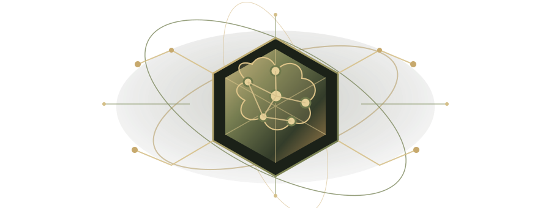

<!-- Profile README: warm cinematic developer / AI research identity -->

 

 

  

---

## whoami

<pre>
class Richard:
    name = "Richard D. Silva"
    role = "Software Development Student"
    primary_language = "Python"
    interests = [
        "backend development",
        "automation & system integration",
        "software architecture",
        "artificial intelligence research",
    ]
    current_mindset = "Learn deeply. Build carefully. Iterate."
</pre>

I am a developer in training focused on understanding how software works beneath the surface. I use projects to turn concepts into practical systems, improve my engineering fundamentals, and document what I learn.

My long-term direction is **AI research and engineering**. Right now, I am strengthening the foundations: Python, backend development, automation, data handling, testing, and software design.

## ./current_focus

| Area | Focus |
|---|---|
| 01 — Python | Writing clear, maintainable Python |
| 02 — Backend | Building reliable application logic and services |
| 03 — Automation | Data validation, processing, and system integration |
| 04 — Engineering | Git, testing, architecture, and documentation |
| 05 — Long term | Mathematics, machine learning, and AI research |

## ./toolkit

## ./selected_repositories

## ./github_activity

 

## ./connect

---

<pre>[ SYSTEM NOTE ]  Curiosity is the entry point. Consistency is the protocol.</pre>

